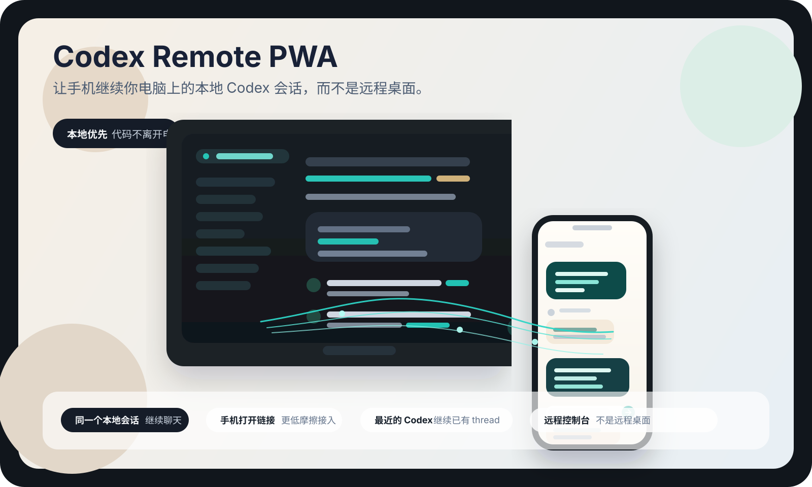

# Codex Remote PWA

[](https://github.com/wp-a/codex-remote-pwa/actions/workflows/ci.yml)

手机上的 Codex 控制台。电脑继续运行真实的 Codex 和本地代码环境，手机只负责发任务、看进度、处理中断和查看输出。

这个项目不是远程桌面，也不是把代码搬到云端的 IDE。它的目标更窄：让你离开电脑后，仍然可以用手机继续管理本机正在进行的 Codex coding 会话。



## 当前状态

现在可以使用：

- 本机直连模式可用：手机和电脑在同一网络，或通过 Tailscale/内网穿透访问本机 bridge。
- Relay + Agent 模式可用：手机通过 WebSocket relay 连接本机 agent，不需要手机直接连到本机 8787 端口。
- Codex 发送任务可用：支持继续已有 session、新建 session、发送 prompt、查看实时输出。
- 运行中控制可用：支持运行中轮询、禁止重复发送、中断当前任务。
- 截图显示可用：本地图片会通过 bridge 图片代理加载。
- 错误展示可用：常见的 `Codex exited with code 1` 会转成更可读的中文提示。

仍然是 MVP：

- Relay 默认是轻量内存配对，不是完整生产级账号系统。
- 授权请求目前能展示和持久化，但上游 app-server 的完整 approve/reject 闭环还需要继续补齐。
- 直连设置页已提供手机访问二维码；Relay 配对码仍需要通过接口创建。
- 没有做终端、文件浏览器、Git 面板、PTY cell grid，这些先不重复造 Lunel 的完整 IDE。

## 为什么做这个

典型场景：

- 电脑上开着 Codex 在修项目。
- 你离开电脑，只带手机。
- 你想看 Codex 是否卡住、是否需要授权、最后输出是什么。
- 你想继续发一句任务，比如“继续实现 A”、“中断当前任务”、“只回复 OK”。

传统远程桌面能做到这些，但手机上操作很重。`Codex Remote PWA` 走的是更轻的路：电脑负责执行，手机只显示高价值状态和关键控制。

## 架构

### 本机直连

```text
手机浏览器 / PWA
  -> HTTP + WebSocket bridge
  -> SQLite session store
  -> Codex runtime adapter
      -> codex app-server
      -> codex exec --json
```

### Relay + Agent

```text
手机浏览器 / PWA
  -> WebSocket Relay
  -> 本机 codex-remote-agent
  -> 本机 bridge server
  -> Codex runtime adapter
```

这个分层借鉴了 Lunel 的核心思路：手机是纯 UI，Relay 只转发，本机 Agent 负责所有真实执行。本项目目前只聚焦 Codex 控制，不做完整 mobile IDE。

## 功能

- 手机端 Apple 风格 PWA 控制台
- 当前会话控制中心
- 最近 Codex thread 导入
- 已导入 session 列表
- 继续当前会话发送任务
- WebSocket 实时输出
- 运行中状态轮询
- 远程中断
- 本地图片代理
- 本地只读模式
- CLI runtime fallback
- app-server runtime adapter
- Relay pairing
- 本机 Agent 代理 bridge API

## 快速开始：本机直连

```bash
npm install
npm run build
npm run remote
```

`npm run remote` 会同时启动 Codex app-server 和 bridge。首次运行会在
`~/.codex-remote-pwa/config.json` 生成由 64 个十六进制字符组成的强随机 token 和默认端口 `8790`；以后会复用该配置，包括你手动修改并保存的有效端口。

启动后，终端会打印本机、局域网和检测到的 Tailscale 候选链接，并为优先链接显示二维码。电脑浏览器可打开本机链接，手机可扫描二维码或打开它能访问的候选链接。按 `Ctrl+C` 会同时停止 app-server 和 bridge。

链接中的 `token` 是访问凭证，应像密码一样妥善保管。不要把 bridge 端口直接暴露到公网。

### 高级：手动启动

需要自行控制进程或环境变量时，可以分别启动：

```bash
codex app-server --listen ws://127.0.0.1:8766
```

另开一个终端：

```bash
BRIDGE_TOKEN=change-me \
CODEX_APP_SERVER_URL=ws://127.0.0.1:8766 \
npm run start --workspace @codex-remote/server
```

手动启动 bridge 的默认端口仍为 `8787`，页面地址是：

```text
http://127.0.0.1:8787/?token=change-me
```

如果不设置 `CODEX_APP_SERVER_URL`，bridge 会回退到 `codex exec --json`。

## 快速开始：Relay + Agent

### 1. 启动 bridge

```bash
BRIDGE_TOKEN=change-me npm run start --workspace @codex-remote/server
```

### 2. 启动 relay

```bash
RELAY_PORT=8788 npm run start --workspace @codex-remote/relay
```

### 3. 创建配对码

```bash
curl -X POST http://127.0.0.1:8788/api/pairings
```

返回示例：

```json
{
  "code": "ABCD1234",
  "expiresAt": "2026-04-30T12:00:00.000Z",
  "appWsUrl": "ws://127.0.0.1:8788/api/relay/app?pair=ABCD1234",
  "agentWsUrl": "ws://127.0.0.1:8788/api/relay/agent?pair=ABCD1234"
}
```

### 4. 启动本机 Agent

```bash
npm run start --workspace @codex-remote/agent -- \
  --relay http://127.0.0.1:8788 \
  --pair ABCD1234 \
  --bridge http://127.0.0.1:8787 \
  --token change-me
```

### 5. 手机打开 Relay 链接

```text
http://127.0.0.1:8787/?relay=http://127.0.0.1:8788&pair=ABCD1234
```

真实手机使用时，`relay` 和 PWA 地址需要换成手机能访问的地址。例如 Tailscale、Cloudflare Tunnel、反向代理或公网部署的 relay。

## 外网访问建议

优先推荐 Tailscale，避免把本机 bridge 端口直接裸露到公网。`npm run remote` 只会通过 `tailscale ip -4` 读取当前 Tailscale IPv4 地址并打印 `8790` 候选链接，不会安装或配置 Tailscale，也不会启用 Serve 或 Funnel。

只有当电脑和手机已连接到允许互访的 Tailscale 网络时，手机才能打开终端打印的 Tailscale 链接。若没有检测到 Tailscale，启动器仍会打印本机和可用的局域网链接；网络接入、ACL 和防火墙需要单独配置。

## 配置

### 启动器

`npm run remote` 使用 `~/.codex-remote-pwa/config.json` 中持久化的 token 和端口，首次生成的默认端口为 `8790`。如需换端口，停止服务后修改该文件中的 `port`，再重新运行启动器。

### Bridge

| 变量 | 默认值 | 说明 |
| --- | --- | --- |
| `PORT` | `8787` | bridge HTTP 端口 |
| `BRIDGE_TOKEN` | `change-me` | 手机访问密码 |
| `CODEX_APP_SERVER_URL` | 空 | Codex app-server WebSocket 地址 |
| `CODEX_BIN` | `codex` | CLI fallback 使用的 Codex 命令 |
| `CODEX_REMOTE_LOCAL_ONLY` | `0` | 设置为 `1` 时只读浏览历史 |
| `DB_PATH` | `./codex-remote.db` | SQLite 数据库路径 |

### Relay

| 变量 | 默认值 | 说明 |
| --- | --- | --- |
| `RELAY_PORT` | `8788` | relay 端口 |
| `RELAY_HOST` | `0.0.0.0` | relay 监听地址 |

### Agent

Agent 支持命令行参数和环境变量：

```bash
codex-remote-agent \
  --relay http://127.0.0.1:8788 \
  --pair ABCD1234 \
  --bridge http://127.0.0.1:8787 \
  --token change-me
```

对应环境变量：

- `CODEX_REMOTE_RELAY_URL`
- `CODEX_REMOTE_PAIR_CODE`
- `CODEX_REMOTE_BRIDGE_URL`
- `CODEX_REMOTE_BRIDGE_TOKEN`

## 仓库结构

```text
packages/shared   共享 schema、类型和 remote protocol
packages/server   本机 bridge server、SQLite、runtime adapter
packages/web      手机优先 PWA
packages/relay    WebSocket pairing relay
packages/agent    本机 Agent，代理 bridge API 和实时事件
protocol/         Codex app-server 协议定义与生成结果
```

## 开发命令

```bash
npm run typecheck --workspaces --if-present
npm test -- --runInBand
npm run build --workspaces --if-present
npm run clean
```

单包启动：

```bash
npm run start --workspace @codex-remote/server
npm run start --workspace @codex-remote/relay
npm run start --workspace @codex-remote/agent -- --relay http://127.0.0.1:8788 --pair ABCD1234
```

## 安全边界

- 手机端不要直接暴露本机文件系统能力。
- Relay 不保存代码、不执行命令，只负责配对和转发。
- Agent 跑在本机，真实权限等同于当前用户。
- `BRIDGE_TOKEN`、包含 token 的访问链接和 pair code 都应视作访问凭证，不要公开分享。
- 公网部署 relay 时应增加 HTTPS、限流、审计和更强的 session token。

## 后续计划

- 在 UI 里生成 Relay pair code 和配对二维码
- 完成 app-server approve/reject 回写闭环
- 增加 relay session token，替代长时间复用 pair code
- 增加 Agent 断线重连和更清晰的连接诊断
- 补充真实产品截图
- 根据需要再评估 PTY、文件浏览、Git 面板，而不是默认做成完整 IDE
